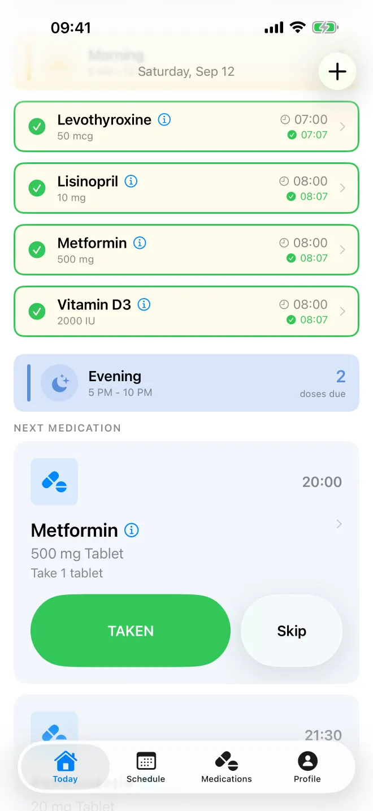
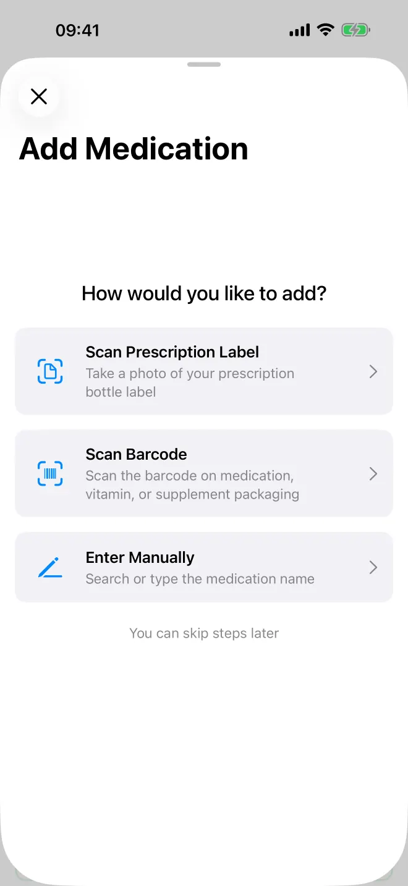
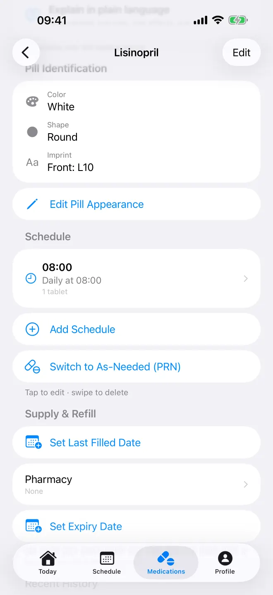
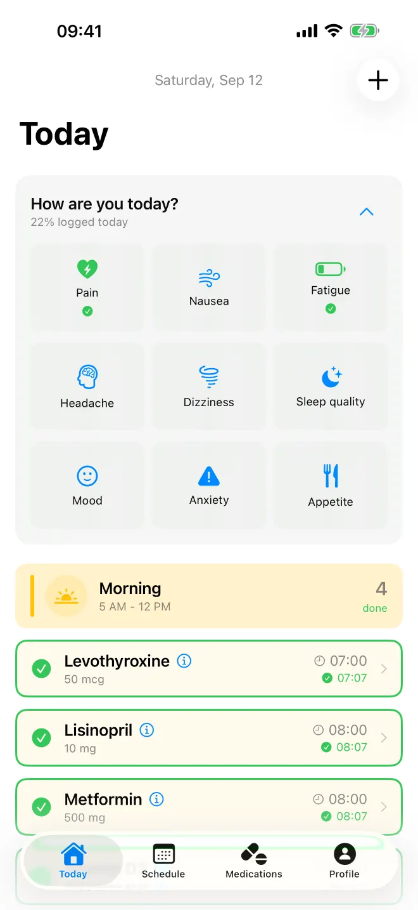
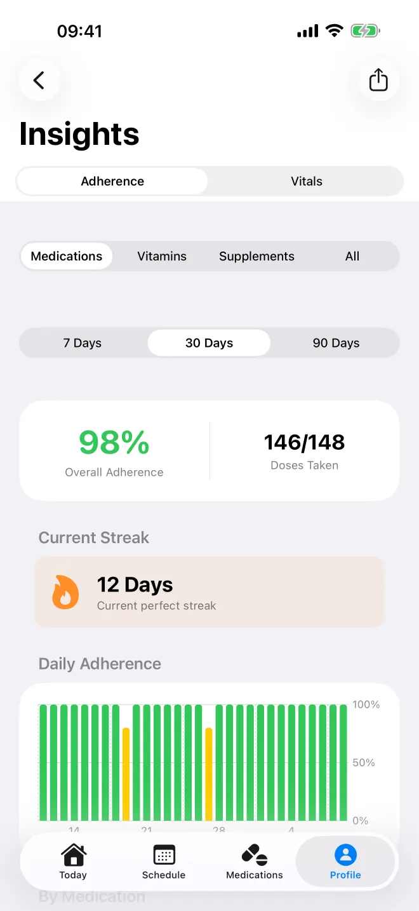
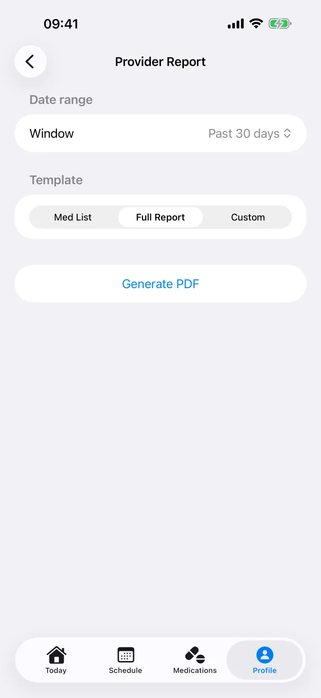

<section class="wrap hero">
  

    <h1>Medication management, made calm.</h1>
    
CRX tracks your doses, reminds you at the times you set, and keeps a record you can bring to your doctor or pharmacist.

    
    

      <a class="btn" href="mailto:{{ site.email }}?subject=CRX%20Launch%20Notification">Email me when CRX launches</a>
    

    
Coming soon to the App Store for iPhone and iPad. We only use your email to tell you about the launch.

    
    

      <a class="btn" href="{{ site.app.store_url }}" target="_blank" rel="noopener">Download on the App Store</a>
    

    
  

  

    

      <strong>Morning</strong>
      0 of 3 taken
    

    <ul>
      <li>
        
<strong>Levothyroxine</strong>50 mcg at 7:00 AM

        <button type="button">Mark taken: Levothyroxine</button>
      </li>
      <li>
        
<strong>Lisinopril</strong>10 mg at 8:00 AM

        <button type="button">Mark taken: Lisinopril</button>
      </li>
      <li>
        
<strong>Metformin</strong>500 mg at 8:00 AM

        <button type="button">Mark taken: Metformin</button>
      </li>
    </ul>
    
Try it. These are sample medications, and nothing is saved.

  

</section>

<section class="moment">
  

    

      <h2>When a dose is due</h2>
      
CRX reminds you at each time you set, and logging a dose takes one tap. The Today view shows what's next and what's done.

      <ul>
        <li>Daily, weekly, interval, and as-needed schedules</li>
        <li>Home Screen widgets and a Lock Screen Live Activity</li>
        <li>Siri shortcuts for logging without opening the app</li>
        <li>Your list, schedule, and logging work without a connection</li>
      </ul>
    

    <figure class="phone">
      
    </figure>
  

</section>

<section class="moment moment--flip">
  

    

      <h2>When you fill a prescription</h2>
      
Add a medication in one of three ways: scan the label on the bottle, scan the barcode on the box, or search the drug database. Check what CRX fills in, then set your times.

      <ul>
        <li>Search runs on RxNorm, from the U.S. National Library of Medicine</li>
        <li>Vitamins and supplements are matched against the NIH Dietary Supplement Label Database</li>
      </ul>
    

    <figure class="phone">
      
    </figure>
  

</section>

<section class="moment">
  

    

      <h2>When you need to check a pill or a refill</h2>
      
Each medication keeps its details together, so you can check the pill in your hand against your record and see when it's time to refill.

      <ul>
        <li>Color, shape, and imprint from FDA label data, plus up to six of your own photos</li>
        <li>A reminder a week before your supply runs out, based on your days' supply</li>
        <li>Expiry dates, and saved pharmacies you can call with a tap</li>
      </ul>
    

    <figure class="phone">
      
    </figure>
  

</section>

<section class="moment">
  

    <h2>When you want to check a combination</h2>
    
CRX uses a cloud AI model to check your list for potential drug interactions, food interactions, and conflicts with allergies you've recorded, then flags anything worth raising with your doctor or pharmacist.

    
Before the first check, CRX shows what it sends and lets you accept or turn the checks off. The <a href="/privacy/">Privacy Policy</a> lists exactly what is sent.

    
AI checks may not catch every interaction, and a missing warning does not mean a combination is safe. Always talk to your doctor or pharmacist before you change how you take a medication.

  

</section>

<section class="moment moment--flip">
  

    

      <h2>When you want to note how you feel</h2>
      
Recording a symptom takes a few taps. The Insights view then charts your doses and your symptoms side by side, over 7, 30, or 90 days.

      
If you turn on Apple Health, CRX can write your doses there and read vitals like blood pressure, glucose, weight, and heart rate.

    

    

      
      
    

  

</section>

<section class="moment">
  

    

      <h2>Before your appointment</h2>
      
The provider report puts your medications, dose history, refills, symptoms, and the drug safety analysis into one PDF for your doctor or pharmacist. You can also export your dose history as a CSV file.

    

    <figure class="phone">
      
    </figure>
  

</section>

<section class="facts-band">
  

    <h2>Made to be easy to read and use</h2>
    <dl class="facts">
      
<dt>VoiceOver</dt><dd>Controls and medication details are labeled for VoiceOver.</dd>

      
<dt>Dynamic Type</dt><dd>Text scales with your iOS setting, up through the accessibility sizes.</dd>

      
<dt>Tap targets</dt><dd>Built to Apple's 44-point minimum.</dd>

      
<dt>Seven languages</dt><dd>English, German, Spanish, French, Italian, Dutch, and Portuguese (Brazil).</dd>

    </dl>
  

</section>

<section class="moment">
  

    <h2>Your health data stays yours</h2>
    <dl class="facts">
      
<dt>No ads, no data sales</dt><dd>CRX shows no ads, uses no advertising identifiers, does no cross-app tracking, and never sells your health information.</dd>

      
<dt>Upfront about AI</dt><dd>Some AI features use the cloud. The <a href="/privacy/">Privacy Policy</a> lists what each one sends and the choices you have.</dd>

      
<dt>Delete anytime</dt><dd>Delete your account right in the app, and your data is removed from our servers.</dd>

    </dl>
  

</section>


<section class="wrap closing">
  <h2>Hear when CRX launches</h2>
  
Send us an email and we'll let you know when CRX reaches the App Store. We only use your email for that.

  <a class="btn" href="mailto:{{ site.email }}?subject=CRX%20Launch%20Notification">Email me when CRX launches</a>
</section>

